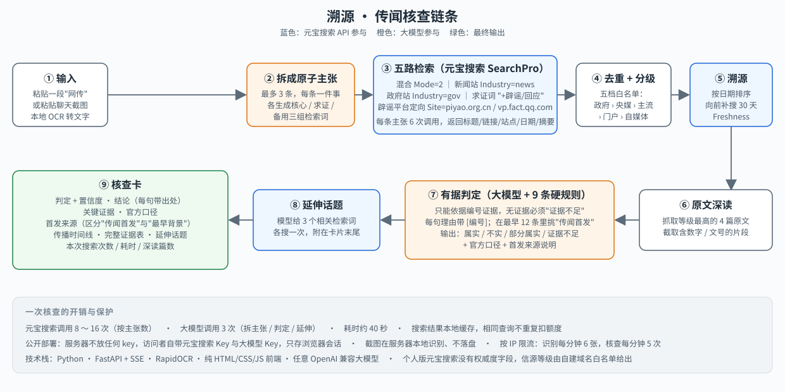

# 溯源：转发之前，先看看它从哪来

基于**腾讯元宝搜索 API** 的网络传闻求证与溯源工具。把一段在群聊、朋友圈、热搜里看到的"网传"粘进来，它会去元宝搜索里把证据翻一遍，给你一张**核查卡**：这事是真是假、官方说过什么、最早是谁传出来的、后面还有哪些相关的事。每句结论都带出处。

> 元宝搜索开发者征文大赛参赛作品。阶段：可演示原型。


体验网站：https://suyuan.changgeng.top/

## 它做什么

1. **拆主张**：用大模型把传闻拆成最多 3 条可公开核实的原子主张，每条生成核心 / 求证 / 备用三组检索词。
2. **五路检索**：调用元宝搜索 `SearchPro`，分别搜混合结果（`Mode=2`）、新闻站（`Industry=news`）、政府站（`Industry=gov`）、带"辟谣"的求证词，以及对中国互联网联合辟谣平台、腾讯较真做站内定向检索（`Site=`）。
3. **去重分级**：按 URL 去重（繁体镜像站合并），用五档域名白名单给信源分级：政府/官方 › 中央媒体 › 主流媒体 › 门户/垂直 › 自媒体/未知。
4. **溯源时间线**：按发布日期排序，在最早一条之前再向前补搜 30 天（`Freshness=`）；由大模型在最早的 12 条里判断哪一条是"最早转述传闻本身"的，区分**传闻首发**与**最早相关背景**。
5. **原文深读**：判定前抓取每条主张里等级最高的 4 篇证据原文，围绕主张关键词（特别是年份、金额、人数、百分比、文号）截取片段，补上搜索摘要里丢掉的细节。
6. **有据判定**：大模型只依据编号证据，按 9 条硬规则输出 属实 / 不实 / 部分属实 / 证据不足，每句理由带 `[编号]`，另给官方口径和首发来源说明。
7. **延伸话题**：生成 3 个相关检索词，各搜一次附在卡片末尾。

一次核查约 8～16 次搜索、3 次大模型调用、40 秒。搜索结果本地缓存，相同查询不重复扣额度。



## 评测结果

40 条人工复核过的传闻（不实 20 条来自中国互联网联合辟谣平台，属实 20 条来自中国政府网、新华网等近一年的政策与事实新闻），数据在 `eval/dataset.jsonl`，四轮结果在 `eval/results/`。

| 轮次 | 改了什么 | 判定准确率 | 不联网基线 |
|---|---|---|---|
| 1 | 初始版本 | 83.8% | 43.8% |
| 2 | 收紧"部分属实"口径，修正 3 条评测数据 | 91.2% | 41.2% |
| 3 | 加入原文深读、JSON 修复重试 | 92.5% | 46.2% |
| 4 | 深读关键词补上"75万亿元"这类数字格式 | 100% | 43.8% |

不联网基线是同一个大模型不搜索直接判断的成绩。四轮是在同一个 40 条上迭代的，模型也有随机性，数字应理解为"在这 40 条上能做到"，而不是对任意传闻的保证。

## 安装与配置

```bash
python3.11 -m venv .venv
.venv/bin/pip install -r requirements.txt
cp .env.example .env
```

`.env` 里要填两样东西：

- `TENCENTCLOUD_WSA_APIKEY`：元宝搜索的「服务 API KEY」，`sk-` 开头，在[元宝搜索控制台](https://console.cloud.tencent.com/wsapi/index)「概览 › 服务 API KEY 方式」创建。注意不是腾讯云账号的 SecretId（`AKID` 开头）。服务刚开通后 key 可能要过几分钟才生效，期间会返回 `UnauthorizedOperation`。也可以改用 `TENCENTCLOUD_SECRET_ID` + `TENCENTCLOUD_SECRET_KEY` 走腾讯云签名方式。
- `LLM_BASE_URL` / `LLM_API_KEY` / `LLM_MODEL`：任意 OpenAI 兼容的大模型接口。推理模型（如 Kimi K2.6 / K3）请设 `LLM_THINKING=off`。Kimi Code 会员 key（`sk-kimi-` 开头）用 `https://api.kimi.com/coding/v1` + `kimi-for-coding`，代码会自动关闭思考模式。

## 运行

```bash
# 网页版
.venv/bin/streamlit run app.py

# 命令行：进度到 stderr，核查卡 Markdown 到 stdout
.venv/bin/python cli.py "网传：2025年起全国取消高速公路节假日免费通行政策"
.venv/bin/python cli.py --file rumor.txt --json out.json
.venv/bin/python cli.py "……" --no-llm       # 只检索分级，不调大模型

# 评测：逐条结果写入 eval/results/<时间戳>.jsonl
.venv/bin/python eval/run_eval.py --baseline
.venv/bin/python eval/build_dataset.py --per-label 20   # 重新从辟谣平台/政府网采集候选并改写（需人工复核）
```

## 目录

| 文件 | 职责 |
|---|---|
| `suyuan/search.py` | 元宝搜索客户端：API KEY 与 TC3 签名两种鉴权，磁盘缓存，统计真实请求数 |
| `suyuan/sources.py` | 域名白名单五档信源分级，URL 规范化 |
| `suyuan/claims.py` | 主张抽取与检索词生成，大模型失败时规则兜底 |
| `suyuan/fetch.py` | 原文深读：抓取网页正文并按关键词截取片段 |
| `suyuan/verify.py` | 核心流水线与数据结构（Evidence / TimelineItem / Report） |
| `suyuan/llm.py` | OpenAI 兼容大模型客户端，稳健 JSON 解析与修复重试 |
| `suyuan/report.py` | Markdown 核查卡 |
| `suyuan/ui.py` / `app.py` | Streamlit 网页 |
| `cli.py` | 命令行入口 |
| `eval/run_eval.py` | 评测脚本（准确率、官方信源命中率、耗时、不联网基线） |
| `eval/build_dataset.py` | 评测集采集与改写脚本 |
| `eval/dataset.jsonl` | 40 条人工复核后的评测集；`dataset.auto.jsonl` 是复核前的自动版本，`dataset_candidates.jsonl` 是全部候选及取舍原因 |
| `eval/results/` | 四轮评测的逐条结果与日志 |
| `article/` | 架构图与宣传图 |

## 已知限制

- 个人版元宝搜索不返回权威度字段，信源等级完全依赖白名单，未收录的地方媒体、机构自建域名会被归为"自媒体/未知"，微信公众号无法区分官方号与个人号。
- "首发来源"只是**搜索引擎可见范围内**最早的内容，不等于真正的源头；追不到时会明确说"未找到传闻本身的早期版本"。
- 判定的上限就是搜索能看到的范围：来源文章没进检索结果时，相关细节会被标为无法核实。
- 还不支持截图输入，也搜不到短视频里的内容。
